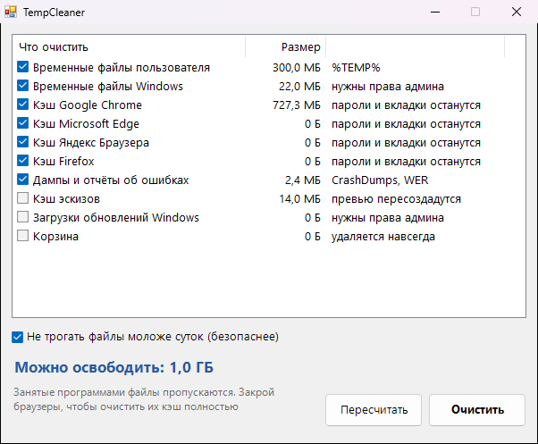

<div align="center">

# 🧽 TempCleaner

**Чистит временные файлы, кэш браузеров и прочий мусор. Перед удалением показывает, сколько места освободится**




</div>

## ✨ Возможности

- 📊 Сначала считает, сколько занимает каждая категория, и только потом удаляет то, что отмечено
- 🌐 Кэш Chrome, Edge, Яндекс Браузера и Firefox (все профили). Пароли, куки, история и вкладки не трогаются
- 🗂️ Временные файлы пользователя и Windows, дампы ошибок, кэш эскизов, загрузки обновлений, корзина
- 🕐 По умолчанию не удаляет файлы моложе суток: их могут использовать запущенные программы
- 🔒 Занятые файлы просто пропускаются, ничего не ломается
- 🔐 Чтобы почистить системные папки, запусти от имени администратора

## 💡 Когда пригодится

- На диске C: осталось несколько гигабайт
- Браузер начал тормозить или странно показывать сайты
- Регулярная уборка раз в месяц

## 📥 Установка

1. Скачай `TempCleaner.exe` из раздела [**Releases**](../../releases/latest)
2. Запусти его, установка не нужна

## 🛠️ Сборка из исходников

Нужен только Windows: компилятор C# входит в состав .NET Framework.

```bat
build.bat
```

## 📄 Лицензия

[MIT](LICENSE)
